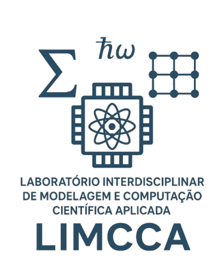
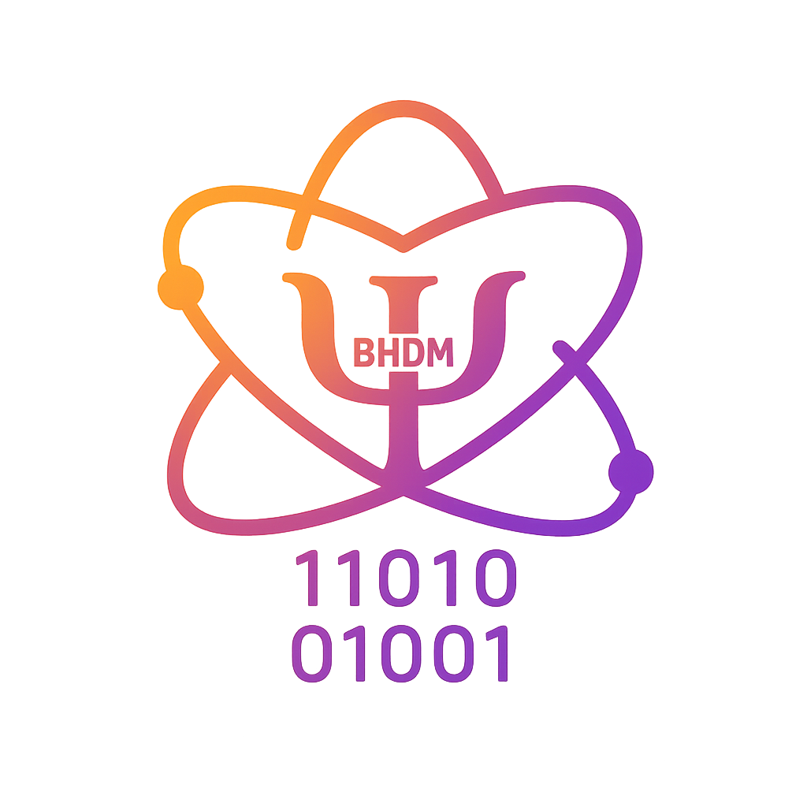
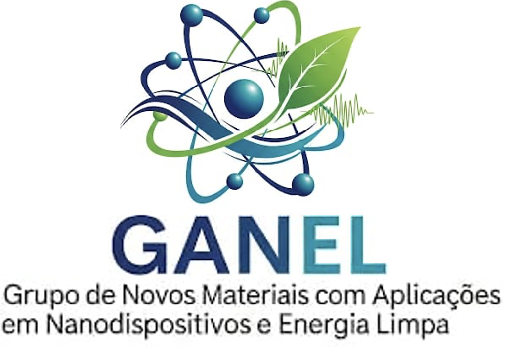

<h1 align="center">Hi, I'm Bruno H. D. Macedo! 👋</h1>

  

  <strong>Physical Engineer | MSc Student in Applied Physics | Scientific Researcher</strong> 
  Universidade Federal da Integração Latino-Americana (UNILA)

  <a href="https://brunohdmacedo.tech">Personal Website</a> ·
  <a href="https://brunohdmacedo.tech/bruma/">Bruma DFT</a> ·
  <a href="https://github.com/brunohdmacedo">GitHub</a>

  

---

<h2 align="center">🔬 About Me</h2>

I am a Physical Engineer graduated from the Federal University of Latin American Integration (UNILA) and currently pursuing a Master's degree in Applied Physics (PPGFISA/UNILA), supported by a CNPq scholarship.

My academic and research background combines Computational Physics, Materials Science, Artificial Intelligence, Machine Learning, Deep Learning, and Data Science. I have experience in scientific research involving time-series data mining, predictive models for materials discovery, and first-principles calculations based on Density Functional Theory (DFT).

My research interests focus on the investigation of advanced materials, particularly metal hydrides and hydrogen storage systems, exploring their structural, thermodynamic, electronic, and mechanical properties through computational simulations.

Throughout my academic journey, I have participated in undergraduate research projects, scientific initiation programs, extension activities, and teaching assistance in Calculus, Basic Mathematics, and General Physics. My work has received recognition at scientific events, including an Honorable Mention at SIEPE 2024 for research involving Machine Learning applied to materials discovery and the 2023 CREA-PR Best Extension Project Award.

I am particularly interested in interdisciplinary research and in developing computational tools that connect Physics, Mathematics, Artificial Intelligence, and Materials Science to solve scientific and technological challenges.

---

<h2 align="center">🧪 Research Interests</h2>

  
  
  
  
  
  
  
  

---

<h2 align="center">🛠️ Languages and Tools</h2>

<h3 align="center">Programming and Development</h3>

  

<h3 align="center">Scientific Computing and Research</h3>

  
  
  
  
  

---

<h2 align="center">🚀 Featured Projects</h2>

<h3>🔬 Bruma DFT — Computational Materials Analysis</h3>

Bruma DFT is a computational project focused on processing and visualizing CASTEP simulation results, providing tools for analyzing electronic and structural properties of materials.

  
  
  

  <strong>Main features:</strong> 
  Electronic Band Structures · DOS · PDOS · Charge Density · Defect Analysis

---

<h2 align="center">📊 GitHub Statistics</h2>

  
  

<h2 align="center">🐍 Contribution Snake</h2>

  

---

<h2 align="center">🤝 Research Groups and Affiliations</h2>

My academic trajectory has involved interdisciplinary research and collaboration with research groups at UNILA, including activities related to Applied Computing, Materials Characterization, Computational Modeling, and Materials Science.

  
  
  
  

---

<h2 align="center">🌐 Let's Connect</h2>

  
  
  
  
  

  <i>Exploring the intersection of Physics, Artificial Intelligence, and Materials Science.</i> 
  <strong>Science, computation, and innovation for a sustainable future. 🔬</strong>

